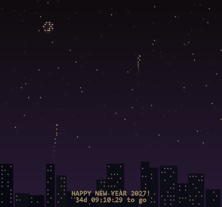
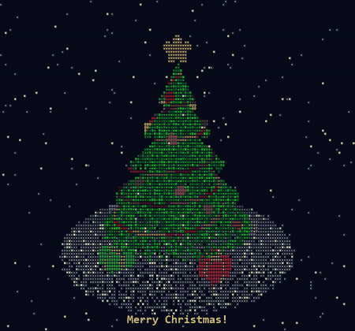
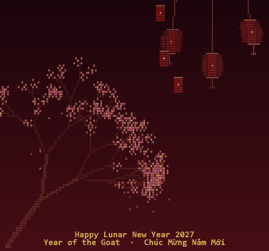
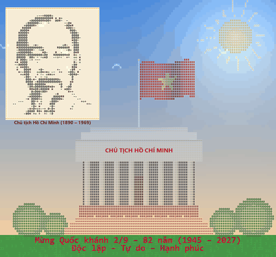
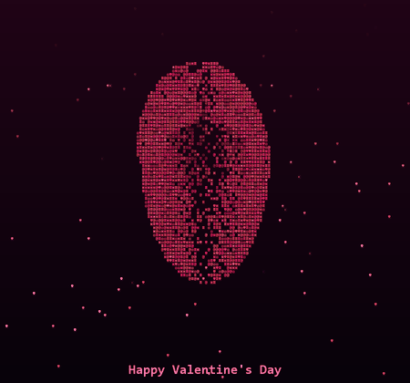
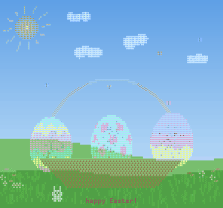
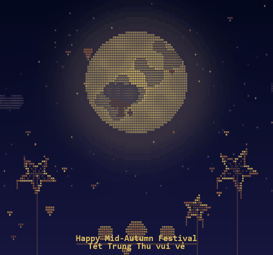
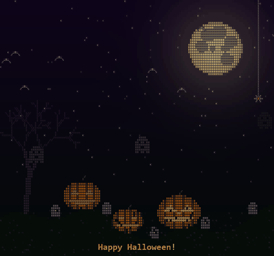
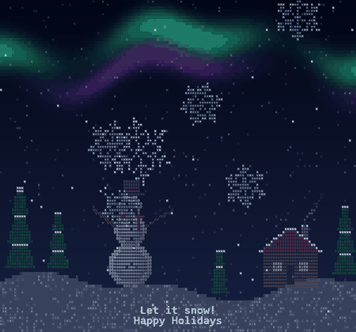
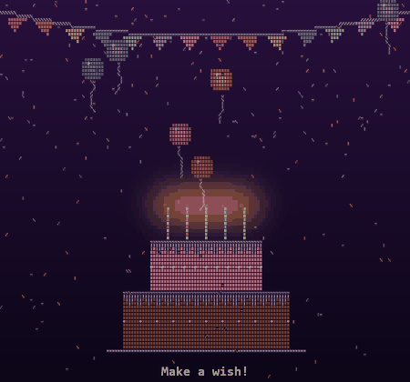

# 🎉 Holiday ASCII

Animated, colourful **ASCII-art scenes for the holidays**, written in Python.
Every frame is drawn entirely with characters such as `* + x # @ o = ♥` on a grid
of coloured cells. Some scenes are real 3D point clouds and others are particle
simulations.

<p align="center">
  
</p>

## 🎬 Demo

<table>
  <tr>
    <td align="center"><br><b>Christmas Tree</b><br><code>christmas-tree</code></td>
    <td align="center"><br><b>Lunar New Year</b><br><code>lunar-new-year</code></td>
    <td align="center"><br><b>Vietnam National Day</b><br><code>national-day</code></td>
  </tr>
  <tr>
    <td align="center"><br><b>Valentine Heart</b><br><code>valentine</code></td>
    <td align="center"><br><b>Easter</b><br><code>easter</code></td>
    <td align="center"><br><b>Mid-Autumn Festival</b><br><code>mid-autumn</code></td>
  </tr>
  <tr>
    <td align="center"><br><b>Halloween</b><br><code>halloween</code></td>
    <td align="center"><br><b>Winter Wonderland</b><br><code>winter</code></td>
    <td align="center"><br><b>Birthday</b><br><code>birthday</code></td>
  </tr>
</table>

Run any of them with `python run.py <name>`. The GIFs are recorded by the program itself (see [Recording demos](#-recording-demos)).

## ✨ Themes

| Theme | Command | What you'll see |
|---|---|---|
| 🎄 **Christmas Tree** | `python run.py christmas-tree` | A rotating 3D tree with five tiers, a spiral garland, blinking baubles, a golden star, gift boxes and falling snow |
| 🎆 **New Year Fireworks** | `python run.py new-year` | Rockets over a city skyline that burst into 11 patterns, plus the new year's number written in sparks and a live countdown |
| 🧧 **Lunar New Year** | `python run.py lunar-new-year` | A peach-blossom branch that grows and blooms, drifting petals, swaying red lanterns and falling lucky envelopes |
| 💖 **Valentine Heart** | `python run.py valentine` | A puffy 3D heart that spins and beats, with floating hearts and twinkling sparkles |
| 🐰 **Easter** | `python run.py easter` | Three painted 3D eggs (stripes, polka dots, zigzag with hearts) spinning in a woven basket, a hopping bunny, butterflies, a rotating sun and grass swaying in the wind |
| 🌕 **Mid-Autumn Festival** | `python run.py mid-autumn` | A giant full moon with the banyan tree, drifting clouds, rising sky lanterns, rotating five-pointed star lanterns and mooncakes |
| 🎃 **Halloween** | `python run.py halloween` | A graveyard with flickering jack-o'-lanterns, flapping bats, see-through ghosts, a dangling spider, rolling fog and lightning |
| ⛄ **Winter Wonderland** | `python run.py winter` | A waving snowman, a log cabin with chimney smoke, snowy pines, an aurora and big rotating six-armed snowflakes |
| 🇻🇳 **Vietnam National Day (2/9)** | `python run.py national-day [photo]` | The Ho Chi Minh Mausoleum under a bright sun, the red flag with the yellow star waving on its roof, white doves, and a framed ASCII portrait of President Ho Chi Minh made from an image |
| 🎂 **Birthday** | `python run.py birthday [name] [age]` | A two-tier cake whose candles you can blow out, balloons, waving bunting and spinning confetti |

Run `python run.py` with no arguments to pick a theme from a menu.
Example: `python run.py birthday Alice 25` shows *"Happy 25th Birthday, Alice!"*.

### Portraits from images

The National Day theme turns an image into ASCII art. By default it loads
`themes/national_day/assets/portrait.png` (`.jpg`, `.jpeg` and `.gif` also work). You can also
pass a path: `python run.py national-day my_photo.png`.

- An ink drawing or stencil on light paper is detected automatically. It is drawn as dark
  characters on a cream panel, and darker strokes get denser characters.
- A normal photo is drawn in its own colours on a dark panel.
- PNG, JPG and GIF are supported. Pillow is in `requirements.txt`. Without Pillow, only PNG and GIF load.

The same converter is available to any theme as `engine.image_to_cells(path, max_cols, max_rows, ink=None)`.

### Firework patterns

`peony` · `rainbow` · `ring` · `double ring` · `heart` · `star` · `willow` · `palm` ·
`crossette` (sparks that split again) · `glitter` · `spiral` · **year number** (e.g. `2027`)

## 🎮 Controls

| Key | Action | Themes |
|---|---|---|
| `SPACE` | Pause / resume | all |
| `R` | Restart the scene | all |
| `ESC` | Quit | all |
| `F` | Launch a grand finale | New Year |
| Mouse click | Launch a rocket that bursts where you clicked | New Year |
| `M` | Switch between peach (pink) and apricot (yellow) blossoms | Lunar New Year |
| `L` | Strike lightning | Halloween |
| `B` | Blow out / relight the candles | Birthday |
| `C` | Confetti burst | Birthday |

## 🚀 Getting started

Requires **Python 3.9+**. `tkinter` ships with the standard Python installer on Windows and macOS.

```powershell
# 1. Create and activate a virtual environment
python -m venv .venv
.\.venv\Scripts\Activate.ps1          # macOS / Linux: source .venv/bin/activate

# 2. Install dependencies
pip install -r requirements.txt

# 3. Run
python run.py
```

> If PowerShell says *"running scripts is disabled"*, run
> `Set-ExecutionPolicy -Scope CurrentUser RemoteSigned` once and activate again.
>
> On some Linux distributions tkinter is a separate package, e.g. `sudo apt install python3-tk`.

## 🎥 Recording demos

The engine can save a theme as an animated GIF without opening a window. Every frame is
rendered at full resolution, so the characters stay sharp.

```powershell
# one theme (default start time and length are set per theme in run.py)
python run.py new-year --record docs/demo/new-year.gif

# custom timing: 8 seconds, starting 5 seconds into the scene
python run.py halloween --record halloween.gif --start 5 --seconds 8

# re-record every demo in docs/demo/
python run.py --record-all
```

## 📁 Project structure

```
Holiday/
├── run.py                      # Launcher: menu, `python run.py <theme>`, --record
├── requirements.txt
├── docs/demo/                  # Demo GIFs shown in this README
├── engine/                     # Shared ASCII rendering engine
│   ├── font.py                 #   5x7 bitmap font for every glyph
│   ├── canvas.py               #   Coloured character grid, z-buffer, PPM output
│   ├── projection.py           #   3D rotation + perspective projection
│   ├── shapes.py               #   Discs, lines, rotation, star outlines, clouds
│   ├── sprites.py              #   Sprites drawn from ASCII art
│   ├── image.py                #   Image -> coloured ASCII cells (photo or ink mode)
│   ├── record.py               #   Scene -> animated GIF (Pillow)
│   └── app.py                  #   Scene base class + Tkinter window / game loop
└── themes/
    ├── christmas_tree/scene.py
    ├── new_year_fireworks/scene.py
    ├── lunar_new_year/scene.py
    ├── valentine_heart/scene.py
    ├── easter/scene.py
    ├── mid_autumn/scene.py
    ├── halloween/scene.py
    ├── winter/scene.py
    ├── national_day/scene.py   #   + assets/portrait.png
    └── birthday/scene.py
```

## 🧩 Adding a new theme

1. Create `themes/my_theme/__init__.py` (empty) and `themes/my_theme/scene.py`:

   ```python
   import numpy as np
   from engine import Scene, G

   class MyTheme(Scene):
       title = "My Theme"
       background = ((10, 10, 30), (0, 0, 0))      # top -> bottom gradient

       def reset(self):
           self.x = np.random.uniform(0, self.cols, 100)
           self.y = np.random.uniform(0, self.rows, 100)

       def update(self, dt, t):
           self.y = (self.y + 10 * dt) % self.rows

       def draw(self, canvas, t):
           canvas.plot(self.x, self.y, G["*"], (255, 255, 255))

       def caption(self, t):
           return "Hello!"

   SCENE = MyTheme
   ```

2. Register it in `THEMES` inside `run.py`.

Useful engine pieces:

- `canvas.plot(cols, rows, glyph, color, depth=None)` draws characters. Pass `depth` to use the z-buffer for 3D scenes.
- `project(points, canvas, angle, tilt, ...)` turns 3D points into grid coordinates.
- `G["*"]` gives the id of a glyph. Glyphs are defined in `engine/font.py`, and you can add your own there.
- `ASPECT` is the cell height divided by its width. Multiply x by it so circles look round.
- `Sprite(art, palette)` turns ASCII art into a drawable sprite, and `sprite.draw(canvas, x, y, brightness, flip)` draws it:

  ```python
  BAT = Sprite(["\\   /", " \\@/ "], {"@": ("@", (150, 110, 170))})
  ```
- `disc`, `line`, `rotate`, `star_outline` and `blob` (a fluffy cloud) return cell coordinates that you pass to `canvas.plot`.

## 🗓️ Ideas for more themes

🦃 Thanksgiving (falling maple leaves, a turkey fanning its tail) ·
🕎 Hanukkah / 🪔 Diwali (lights igniting one by one) · 🎆 National Day night mode (fireworks over the mausoleum) ·
🌸 Women's Day (a rose opening petal by petal) · 🍀 St. Patrick's Day (shamrocks, a rainbow, a pot of gold)

Contributions are welcome!

## 🛠️ Built with

- **numpy**: vectorised math for tens of thousands of points and particles per frame
- **tkinter**: window, keyboard and mouse input
- **Pillow**: GIF recording and JPG loading
- A custom 5×7 glyph font. Frames are rendered as PPM images straight into a Tk `PhotoImage`.

---

Happy holidays! 🎄🎆🧧💖🐰🌕🎃⛄🎂
